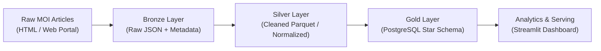

# Egyptian Ministry of Interior (MOI) Crime News Intelligence Pipeline
## Literature Review & Architectural Justification (Milestone 2)

**Digital Egypt Pioneers Initiative (DEPI)**  
**Track:** Microsoft Data Engineer  
**Training Partner:** Skills Dynamix  
**Group Code:** ALX5_AIS5_S5  
**Round:** Round 5  
**Project Title:** Egyptian Ministry of Interior (MOI) Crime News Intelligence Pipeline & Analytics Platform  
**Repository:** [nhahub/NHA-5-079](https://github.com/nhahub/NHA-5-079)  
**Supervisor / Lecturer:** Eng. Ahmed Azab  
**Submission Date:** 16 October 2026  

---

## 1. Introduction & Background

In modern public policy and smart governance, spatial-temporal crime analytics plays a vital role in resource allocation, crime prevention, and public transparency. Worldwide, public safety organizations and law enforcement agencies have transitioned from manual, paper-based incident logging to automated, real-time data ingestion pipelines feeding centralized analytical data warehouses.

However, in many developing nations—including Egypt—official public safety data is largely disseminated in unstructured natural language formats, such as daily press releases, judicial statements, and official social media communications from the Ministry of Interior (MOI). While these publications contain rich data regarding criminal incidents, locations, dates, involved parties, and judicial outcomes, the absence of an open, machine-readable API creates a substantial data gap for researchers, policy analysts, and data practitioners.

This literature review evaluates global state-of-the-art implementations of crime data platforms, examines natural language extraction paradigms for low-resource Arabic text, and provides a rigorous engineering justification for the architectural decisions adopted in this project.

---

## 2. Global Precedents & Public Crime Data Platforms

To establish industry benchmarks, we examine two prominent international public security data platforms:

### 2.1 The City of Chicago Crime Data Portal
- **Architecture:** The City of Chicago operates one of the most mature municipal open data portals globally (built on the Socrata platform). Incident reports logged by the Chicago Police Department (CPD) are extracted through automated batch ETL pipelines, sanitized for citizen privacy, and published as a unified tabular dataset containing over 7 million historical records dating back to 2001.
- **Data Attributes:** Each record captures a case number, standardized FBI crime code (IUCR), primary crime description, secondary location description (e.g., street, residence, gas station), beat/district codes, ward, geographic coordinates (latitude/longitude), and arrest status.
- **Key Takeaways:** 
  1. The dataset strictly separates transactional incident records from analytical dimensions (location, crime type, temporal hierarchy).
  2. Spatial coordinates are essential for downstream kernel density estimation (heatmaps) and hot-spot detection.

### 2.2 The UK Police National Data API (`data.police.uk`)
- **Architecture:** The United Kingdom provides an open RESTful API and bulk download service covering 43 territorial police forces across England, Wales, and Northern Ireland.
- **Design Principles:** Incidents are anonymized using spatial snapping (coordinates are snapped to predefined public points of interest to preserve victim privacy) and categorized into standardized crime categories (e.g., violent crime, burglary, public order).
- **Key Takeaways:** 
  1. A consistent dimensional taxonomy is required to enable cross-regional comparisons.
  2. Public reporting requires automated data quality checks to prevent duplicate submissions and coordinate drift.

### 2.3 Gap Analysis: The Egyptian Context
Unlike Chicago or the UK, Egypt does not provide a structured crime API. Public security communications from the Egyptian Ministry of Interior are narrative, unstructured Arabic text. Consequently, developing an analytics platform requires building the entire ingestion, extraction, and harmonization pipeline from scratch—converting semi-structured and unstructured narrative statements into a structured analytical warehouse.

---

## 3. Information Extraction & NLP for Narrative Arabic Text

Extracting structured data (crime category, governorate, incident date, suspect counts) from narrative Arabic news articles presents distinct computational challenges, including morphological complexity, dialectal variation, and ambiguous geographic nomenclature. We evaluated three primary extraction paradigms:

| Metric / Dimension | 1. Rule-Based Regex / Pattern Matching | 2. Traditional Arabic NER (AraBERT / CAMeL) | 3. Large Language Models (LLMs via Prompting) |
|---|---|---|---|
| **Processing Throughput** | Extremely High ($> 5,000$ articles / min) | Moderate (~200–500 articles / min) | Low (10–50 articles / min due to API latency) |
| **Operational Cost** | \$0.00 (Pure CPU execution) | \$0.00 (Local inference, requires GPU) | High (Token-based API billing or heavy local VRAM) |
| **Output Determinism** | 100% Deterministic (Identical rules = identical output) | High (Confidence scores) | Non-deterministic (Risk of hallucinations & schema drift) |
| **Maintenance Overhead**| Requires regex rule tuning for edge cases | Requires annotated training datasets | High prompt-engineering and rate-limit handling |
| **Rate Limits / Scaling**| Unlimited local execution | Unlimited local execution | Constrained by API rate limits (TPM / RPM) |

### Strategic Decision: The Hybrid Architecture
Based on empirical evaluation, attempting to process 4,700+ full-text articles through external LLM APIs caused severe rate-limiting bottlenecks (yielding only 36 articles over several hours) and high latency. 

Therefore, our architecture implements a **Hybrid Strategy**:
1. **Production Pipeline (High-Throughput Deterministic Engine):** Utilizes Python regular expressions, Arabic character normalization (unifying Alef `أ/إ/آ` $\rightarrow$ `ا`, Taa Marbuta `ة` $\rightarrow$ `ه`), and dictionary-based governorate mapping to reliably process the full corpus of 4,709+ records in under 3 seconds.
2. **GenAI Pilot Evaluation:** A controlled sample of 30–50 articles is processed via LLM prompt engineering to benchmark extraction precision on nuanced crime descriptions, fulfilling the project's exploratory AI requirements without compromising pipeline performance.

---

## 4. Data Architecture & Warehousing Paradigms

### 4.1 Medallion Architecture (Bronze $\rightarrow$ Silver $\rightarrow$ Gold)
Rather than executing a single, brittle end-to-end transformation, our platform adheres to the Databricks Medallion Architecture:
- **Bronze (Raw Ingestion):** Unmodified raw JSON payloads scraped from the MOI portal, preserving original HTML text, timestamps, and scrape metadata. This layer ensures data lineage and enables historic reprocessing.
- **Silver (Cleaned & Harmonized):** Deduplicated, normalized records with resolved geographic coordinates, parsed dates, standardized crime categories, and clean Arabic text, serialized into compressed Apache Parquet.
- **Gold (Business-Level Dimensional Warehouse):** Kimball Star Schema optimized for OLAP aggregations and dashboard queries in PostgreSQL.

### 4.2 Storage Formats: Apache Parquet vs. CSV / JSON
For the Silver layer, Apache Parquet was chosen over CSV and JSON based on the following technical advantages:
- **Columnar Storage:** Queries requesting specific subsets of columns (e.g., `governorate` and `crime_category`) read only the required byte offsets, drastically reducing I/O.
- **Snappy Compression:** Reduces disk footprint by over 70% compared to raw JSON while maintaining microsecond read speeds.
- **Embedded Schema & Types:** Strongly typed columns eliminate silent data type conversion bugs during downstream ingestion.

### 4.3 Dimensional Modeling: Kimball Star Schema vs. 3NF / NoSQL
For the analytical Gold layer, a **Kimball Star Schema** was selected over Third Normal Form (3NF) relational schemas or NoSQL document stores:
- **Query Performance:** Star schemas require significantly fewer joins than 3NF normalized databases, allowing complex spatial-temporal slice-and-dice queries to execute in single-digit milliseconds.
- **Analytical Readability:** Clear separation between business processes (`fact_crime_incident`) and context (`dim_date`, `dim_crime_type`, `dim_location`, `dim_source`) makes the schema intuitive for data analysts and BI tools.
- **Why Not NoSQL:** While MongoDB or Elasticsearch handle unstructured text well, they lack strict relational integrity constraints, foreign key enforcement, and performant SQL aggregation joins essential for reproducible data engineering pipelines.

---

## 5. Workflow Orchestration & Data Quality Engineering

### 5.1 Orchestration: Apache Airflow vs. Cron Scheduling
Legacy data pipelines frequently rely on OS-level `cron` daemons. However, cron lacks essential enterprise data capabilities:
- **Task Dependencies:** Cron cannot model Directed Acyclic Graphs (DAGs) natively; failure in an upstream extraction step does not automatically halt downstream loading.
- **Automated Retries & Backoff:** Transient network timeouts during web scraping crash unmonitored scripts.
- **Observability:** Apache Airflow provides a centralized UI, execution history, SLA tracking, and audit logs.

### 5.2 Test-Driven Data Engineering & Quality Gates
Drawing on the principles of **DataOps** and Defensive Data Engineering, data quality must not be verified manually after dashboard deployment. Instead, automated verification gates are embedded directly into the pipeline:
- Our architecture introduces a dedicated **Quality Gate Task** using `pytest` as the final step in the Airflow DAG.
- If referential integrity fails (e.g., an orphan foreign key in `fact_crime_incident`), or if volume boundaries collapse, the DAG fails immediately and downstream consumers are protected from silent data corruption.

---

## 6. Synthesis & Conclusion

The surveyed literature and industry case studies demonstrate that building a high-value public safety intelligence platform requires:
1. Converting unstructured narrative text into structured records using robust, deterministic extraction supplemented by LLM benchmarking.
2. Structuring data across a multi-tier Medallion architecture for auditability and resilience.
3. Leveraging columnar Parquet storage and a Kimball Star Schema for optimized analytical queries.
4. Enforcing automated data quality gates within an Airflow-orchestrated workflow.

The architecture implemented in this project directly addresses each of these principles, establishing a resilient, scalable, and verifiable crime intelligence platform for Egypt.
